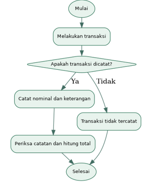
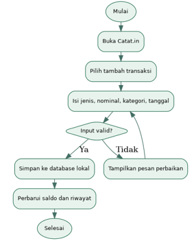

# Catat.in: Analisis Kebutuhan Pengguna dan Karakteristik Perangkat Bergerak

## 1. LATAR BELAKANG

Pengelolaan keuangan pribadi mencakup kegiatan mencatat pemasukan, mencatat pengeluaran, dan memantau uang yang tersedia. Pencatatan yang teratur memungkinkan seseorang menelusuri transaksi dan memahami komposisi pengeluarannya dari waktu ke waktu. Sebaliknya, transaksi yang tidak terdokumentasi dapat menyulitkan dalam mengatur pengeluaran dan pemeriksaan saldo berdasarkan catatan.

Dalam kehidupan sehari-hari, kita dapat melakukan transaksi dengan nominal dan kategori berbeda, misalnya untuk makanan, transportasi, kebutuhan kuliah, dan belanja bulanan. Cara pencatatan yang mungkin digunakan meliputi buku, catatan ponsel, spreadsheet, aplikasi khusus, atau tidak mencatat sama sekali karena sudah terlanjur lupa. Belum ada data lapangan yang memastikan cara mana yang digunakan oleh calon pengguna “Catat.in”. Oleh sebab itu, masih perlu diidentifikasi melalui observasi atau wawancara singkat sebelum ditetapkan sebagai temuan.

Smartphone Android berpotensi mendukung pencatatan transaksi karena bersifat portabel, memiliki antarmuka sentuh, dan menyediakan fasilitas penyimpanan data. Pengguna dapat memasukkan transaksi ketika atau sesaat setelah transaksi terjadi. Agar manfaat tersebut tercapai, alur pencatatan harus sederhana dan informasi keuangan yang ditampilkan harus mudah dipahami.

Atas dasar kebutuhan rancangan tersebut, “Catat.in” diusulkan sebagai aplikasi pencatatan keuangan pribadi berbasis Android. Fungsi inti yang direncanakan meliputi pencatatan pemasukan dan pengeluaran, pengelompokan transaksi berdasarkan kategori, penelusuran riwayat transaksi, dan perhitungan ringkasan saldo dari data yang dimasukkan pengguna. “Catat.in” bukan aplikasi perbankan, dompet elektronik, atau layanan pemindahan uang.

Dokumen ini menganalisis proses yang berjalan, potensi permasalahan, solusi yang ditawarkan, spesifikasi pengembang, dan spesifikasi target. Hasil analisis merupakan dasar rancangan awal yang perlu disesuaikan setelah kebutuhan calon pengguna diverifikasi.

## 2. ANALISIS PERMASALAHAN

### A. Identifikasi potensi permasalahan

Tabel berikut berisi dugaan awal yang perlu diuji, bukan hasil survei atau wawancara.

| No. | Potensi permasalahan | Konsekuensi yang perlu diverifikasi |
| --- | --- | --- |
| 1 | Transaksi tidak selalu dicatat | Riwayat transaksi dapat tidak lengkap |
| 2 | Pengguna mengandalkan ingatan | Nominal atau tujuan transaksi dapat terlupakan |
| 3 | Transaksi tidak dikelompokkan | Pengeluaran per kategori sulit ditinjau |
| 4 | Saldo berdasarkan catatan tidak dihitung secara berkala | Pengguna perlu menghitung ulang pemasukan dan pengeluaran |
| 5 | Proses pencatatan dianggap merepotkan | Pengguna dapat menunda pencatatan |

### B. Flowchart sistem yang berjalan (rancangan awal)

Diagram menggambarkan satu skenario pencatatan manual yang mungkin terjadi, bukan klaim tentang kondisi seluruh calon pengguna. Diagram harus direvisi berdasarkan temuan nyata.

Setelah transaksi terjadi, pengguna dapat memilih mencatatnya pada media yang biasa digunakan atau tidak mencatatnya. Jika dicatat, total transaksi dan saldo mungkin perlu dihitung secara manual, bergantung pada media yang digunakan. Proses aktual harus dipastikan melalui pengumpulan data.

### C. Data Temuan

**Status: belum tersedia. Tidak ada responden, jumlah kasus, persentase, atau hasil wawancara yang diasumsikan dalam dokumen ini.**

Rencana pengumpulan data dengan lakukan observasi atau wawancara singkat kepada calon pengguna yang bersedia. Catat tanggal, metode, kode narasumber, dan jawaban asli, Pertanyaannya:

1. Bagaimana Anda mencatat pemasukan dan pengeluaran saat ini?

1. Kapan dan seberapa sering Anda melakukan pencatatan?

1. Kesulitan apa yang dialami dalam proses tersebut?

1. Bagaimana Anda mengetahui total pengeluaran dan sisa uang?

1. Fitur apa yang paling diperlukan jika tersedia aplikasi pencatatan di HP?

1. Apakah pencatatan perlu dapat dilakukan tanpa internet?

## 3. SOLUSI YANG DITAWARKAN

### A. Gambaran Solusi

Catat.in dirancang sebagai aplikasi Android untuk mencatat transaksi keuangan pribadi, bukan untuk melakukan pembayaran. Pengguna memasukkan jenis transaksi, nominal, kategori, tanggal, dan keterangan opsional. Aplikasi memvalidasi input, menyimpan transaksi, dan memperbarui ringkasan keuangan dari data yang tersimpan.

### B. Fungsi Yang Diusulkan

| Fungsi | Deskripsi | Prioritas |
| --- | --- | --- |
| Catat pemasukan | Menyimpan nominal, tanggal, kategori, dan keterangan | Utama |
| Catat pengeluaran | Menyimpan nominal, tanggal, kategori, dan keterangan | Utama |
| Kategori transaksi | Mengelompokkan transaksi, misalnya makanan atau transportasi | Utama |
| Riwayat transaksi | Menampilkan transaksi yang pernah disimpan | Utama |
| Ubah/hapus transaksi | Memperbaiki pencatatan yang salah | Utama |
| Ringkasan saldo | Menghitung saldo awal + total pemasukan − total pengeluaran | Utama |

Batasan versi awal: tidak mencakup transfer uang, integrasi rekening bank, pembayaran digital, AI, prediksi pengeluaran, atau sinkronisasi multi-perangkat. Penyimpanan lokal dipilih sebagai rancangan awal agar fungsi inti dapat digunakan tanpa internet.

### C. Flowchart Sistem Yang Ditawarkan

Nominal harus lebih besar dari nol, jenis transaksi harus dipilih, tanggal harus valid, dan kategori harus tersedia. Penghapusan atau perubahan transaksi harus diikuti perhitungan ulang ringkasan. Saldo yang ditampilkan merupakan saldo berdasarkan catatan pengguna, bukan saldo rekening bank.

### D. Sumber Referensi

Referensi berikut mendukung pilihan teknologi dan representasi diagram, bukan merupakan bukti empiris bahwa calon pengguna memiliki masalah tertentu.

- Android Developers. *Guide to app architecture*. https://developer.android.com/topic/architecture

- Android Developers. *Save data in a local database using Room*. https://developer.android.com/training/data-storage/room

- Android Developers. *Android Studio*. https://developer.android.com/studio

- Kotlin. *Kotlin documentation*. https://kotlinlang.org/docs/home.html

- GitHub Docs. *Creating diagrams*. https://docs.github.com/en/get-started/writing-on-github/working-with-advanced-formatting/creating-diagrams

## 4. SPESIFIKASI PENGEMBANG

Spesifikasi berikut merupakan usulan kebutuhan pengembangan, bukan hasil uji performa atau persyaratan mutlak perangkat.

| Komponen | Spesifikasi yang diusulkan | Alasan |
| --- | --- | --- |
| Laptop/PC | Prosesor 64-bit kelas menengah; RAM 16 GB disarankan; SSD dengan ruang kosong memadai | Mendukung IDE, build, dan emulator dengan lebih nyaman |
| Sistem operasi pengembang | Windows, Linux, atau macOS yang didukung Android Studio | Lingkungan pengembangan Android |
| IDE | Android Studio versi stabil yang kompatibel | Menulis, membangun, dan menguji aplikasi |
| Bahasa pemrograman | Kotlin | Implementasi aplikasi Android |
| Antarmuka | Jetpack Compose | Membangun antarmuka native Android |
| Database | Room (SQLite lokal) | Menyimpan transaksi tanpa koneksi internet |
| Pengujian | Android Emulator dan minimal satu perangkat Android fisik | Memeriksa fungsi dan tampilan pada perangkat |
| Version control | Git dan GitHub | Menyimpan versi proyek dan dokumen Markdown |

Kebutuhan data inti: transaksi memiliki ID unik, jenis transaksi (pemasukan/pengeluaran), nominal, kategori, tanggal, dan keterangan opsional. Nilai uang disimpan sebagai bilangan bulat dalam satuan rupiah untuk menghindari masalah pembulatan pecahan desimal.

## 5. SPESIFIKASI TARGET YANG DIKEMBANGKAN

Bagian ini mendefinisikan target awal aplikasi dan perangkat pengguna, bukan klaim kompatibilitas yang sudah diuji.

| Aspek | Target rancangan | Keterangan |
| --- | --- | --- |
| Platform | Smartphone Android | Aplikasi mobile native |
| Versi sistem operasi | Android 10 (API 29) atau lebih baru | Target awal; dapat direvisi setelah pengujian |
| RAM perangkat | 3 GB atau lebih | Target awal, bukan minimum terverifikasi |
| Penyimpanan | Ruang kosong yang cukup untuk instalasi dan database transaksi | Ukuran final belum diketahui |
| Layar | Layar sentuh smartphone, orientasi potret | Antarmuka responsif untuk ukuran layar berbeda |
| Koneksi internet | Tidak wajib untuk pencatatan inti | Data disimpan secara lokal |
| Sensor | Tidak memerlukan kamera, GPS, atau NFC | Fungsi utama berbasis input manual |
| Pengguna | Individu yang ingin mencatat keuangan pribadi harian | Segmentasi lebih rinci menunggu temuan lapangan |
| Bahasa antarmuka | Bahasa Indonesia | Sesuai sasaran awal penggunaan |
| Fitur utama | Pemasukan, pengeluaran, kategori, riwayat, edit/hapus, saldo | Ruang lingkup versi pertama |

Kriteria penerimaan awal yang dapat diuji pada tahap implementasi: pengguna dapat menyimpan transaksi valid, menerima pesan untuk input tidak valid, melihat riwayat transaksi, mengubah atau menghapus transaksi, dan memperoleh ringkasan saldo yang konsisten dengan transaksi tersimpan. Pengujian kompatibilitas harus dilakukan sebelum menetapkan spesifikasi minimum final.
